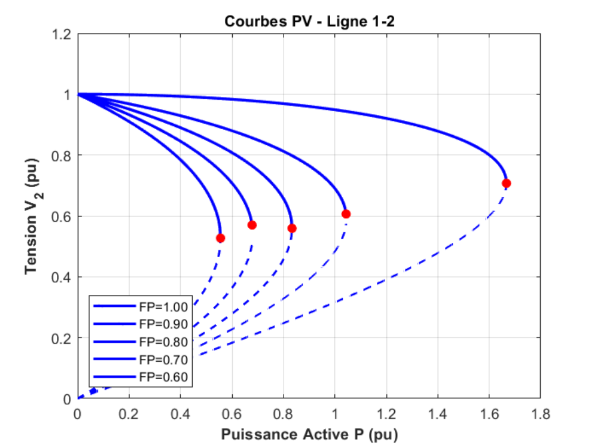
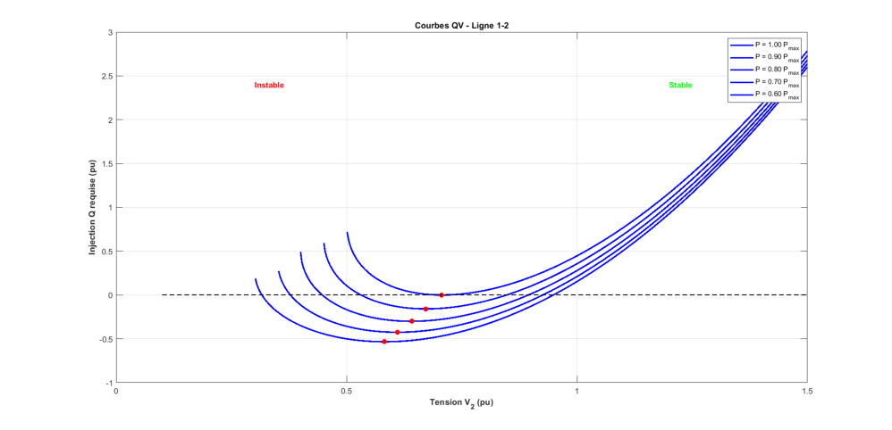
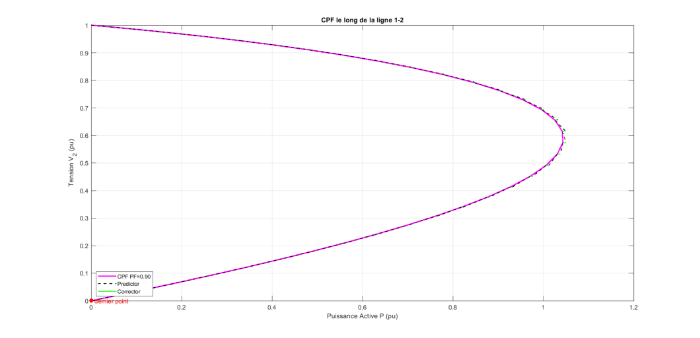

# Voltage Stability Analysis

I developed a MATLAB application to study voltage stability using P–V curves, Q–V curves and continuation power flow, and to compare the effects of loading and power factor.

## Main features

- Selects lines from three-bus and fourteen-bus network examples.
- Plots voltage against active power and reactive-power requirements.
- Identifies critical operating points and traces the continuation curve.

## Results

Figures from the [technical report](docs/voltage-stability-analysis-report.pdf).

### P-V curves

The curves compare different power factors and mark the critical loading points.



### Q-V curves

Reactive-power requirements are shown for several active-power levels.



### Continuation power flow



## Tools

MATLAB, MATLAB graphics and numerical linear algebra.

## Run

Open this folder in MATLAB and run:

```matlab
voltage_stability_app
```

Choose the system, line and analysis type, then enter the operating parameters.

## Project files

| File | Purpose |
| --- | --- |
| `voltage_stability_app.m` | Interactive application |
| `plot_pv_qv_curves.m` | P-V and Q-V calculations and plots |
| `plot_continuation_power_flow.m` | Predictor-corrector continuation |
| `three_bus_data.m`, `fourteen_bus_data.m` | Example network data |

Academic group project at the National Polytechnic School of Algiers.
