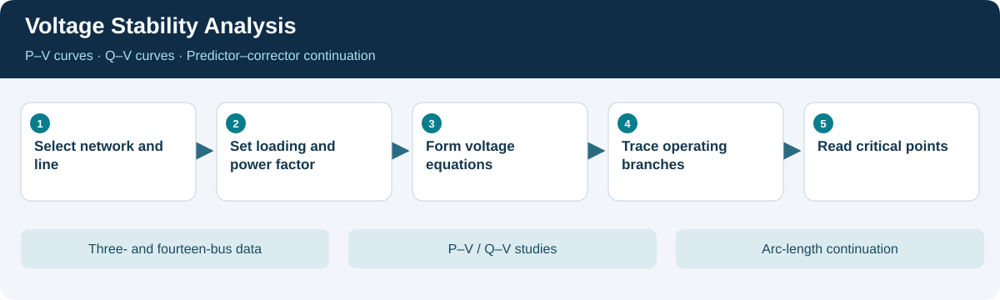
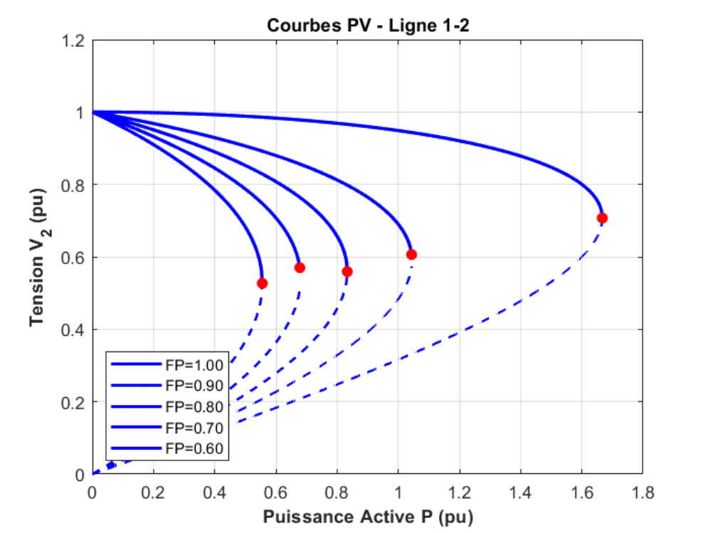
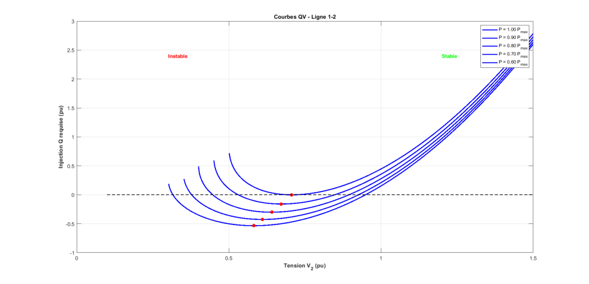
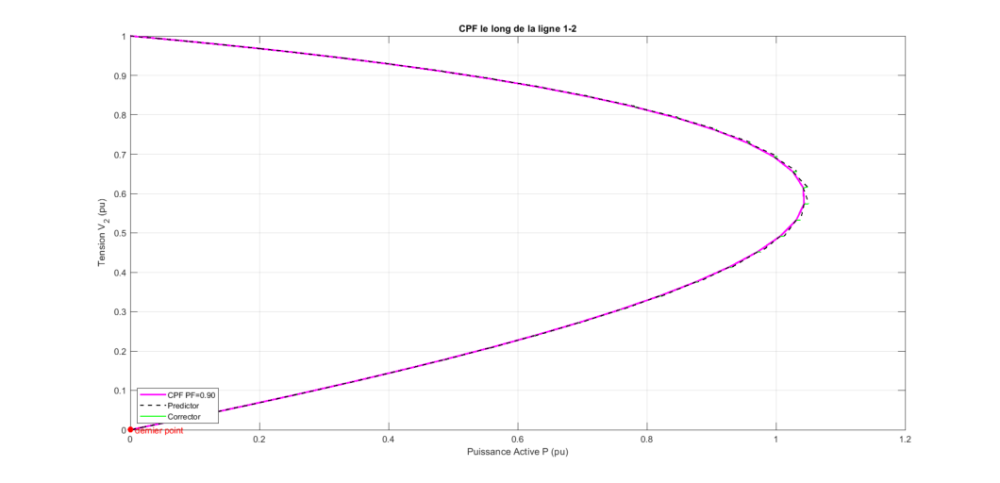

# Voltage Stability Analysis

**P–V curves · Q–V curves · Predictor–corrector continuation**

A MATLAB application for exploring how electrical loading, power factor and reactive-power demand affect receiving-end voltage. The project visualizes the operating branches and critical loading points of a selected line equivalent.

Academic group project at the National Polytechnic School of Algiers.



## Study objectives

| Analysis | Question answered |
|---|---|
| P–V curves | How does receiving-end voltage change as active-power transfer increases? |
| Q–V curves | How does reactive-power demand relate to voltage at a selected active-power level? |
| Continuation power flow | How can the operating curve be followed through its turning region? |

The interface selects a network, a line and the study type. The calculations use the selected source voltage and line reactance to form a two-bus equivalent.

## Operating principle

For a lossless line equivalent, active and reactive power at the receiving end can be written:

$$P=\frac{V_1V_2}{X}\sin\delta,\qquad
Q=\frac{V_1V_2}{X}\cos\delta-\frac{V_2^2}{X}$$

The chosen power factor establishes $Q=P\tan\varphi$. Increasing loading changes both the receiving-end voltage $V_2$ and the angle $\delta$. The high- and low-voltage branches meet at a critical point.

The continuation routine uses a tangent predictor followed by a Newton corrector on an augmented system. Arc-length stepping follows the curve even where active power is no longer a convenient independent parameter.

## Report figures

### P–V curves and critical loading



The curves show how power factor changes the voltage profile and maximum transferable active power in the selected equivalent.

### Q–V characteristics



These plots compare the reactive-power relationship at several active-power levels.

### Continuation trajectory



Predictor and corrector segments make the numerical process visible. All figures come from the [technical report](docs/voltage-stability-analysis-report.pdf).

## Why this implementation

The graphical interface separates case selection from the numerical routines. P–V and Q–V plots provide complementary views of the same voltage/power relationship. The predictor–corrector method adds a geometric view of the solution branch rather than relying only on a sequence of independent load-flow points.

The continuation code starts with a nominal arc-length step of 0.03 and a Newton residual tolerance of $10^{-10}$; it adjusts the step during the trace. These are numerical settings in the supplied implementation.

## Run

```matlab
voltage_stability_app
```

1. Select the three-bus or fourteen-bus dataset.
2. Choose a connected line and an analysis mode.
3. Enter the requested power factor or loading values.
4. Inspect the plotted branches, critical points or continuation steps.

## Files and tools

| File | Role |
|---|---|
| `voltage_stability_app.m` | Graphical interface |
| `plot_pv_qv_curves.m` | P–V and Q–V calculations |
| `plot_continuation_power_flow.m` | Tangent prediction and Newton correction |
| `three_bus_data.m`, `fourteen_bus_data.m` | Example network data |
| [Report](docs/voltage-stability-analysis-report.pdf) | Derivations and worked studies |

**Tools:** MATLAB, numerical linear algebra and MATLAB graphics.

## Related projects

[Power Flow and Network Analysis](https://github.com/MouaadO/power-flow-analysis) · [Power System Fault Location with Machine Learning](https://github.com/MouaadO/power-system-fault-location-ml)
